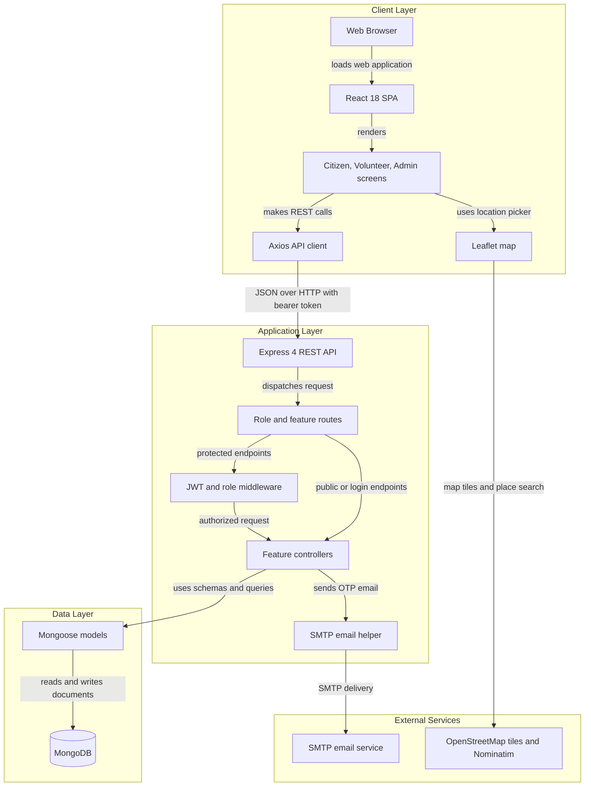
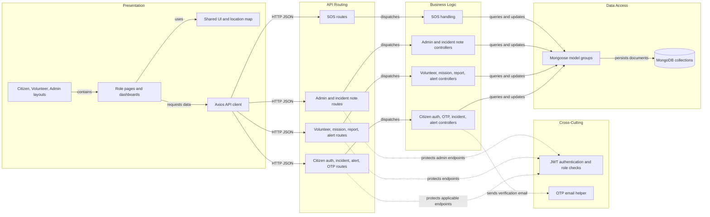

# Architecture Diagram

The Disaster Management System is a browser-based React application with a separate Express API and MongoDB persistence. Citizens, volunteers, and administrators use role-specific screens to report incidents, manage responses, and exchange alerts.

## Application Architecture

<!-- mermaid-checked: no \n, no em-dash/en-dash, no {} in labels, subgraphs are id["label"], arrows are -->|"label"|, all subgraphs closed by end, ids unique -->

### Technology Stack Summary

| Layer | Technology | Version | Purpose |
|---|---|---|---|
| Client | React | `^18.3.0` | Role-based browser interface |
| Client tooling | Vite | `^5.4.10` | Development server and production bundling |
| Client routing | React Router DOM | `^6.30.2` | Page and role-area navigation |
| Client API | Axios | `^1.13.2` | REST requests and bearer-token attachment |
| Client maps | Leaflet and React Leaflet | `^1.9.4`, `^4.2.1` | Incident location selection and display |
| Server | Node.js and Express | Express `^4.22.1`; Node version unspecified | HTTP API and route handling |
| Server security | JSON Web Token and bcryptjs | `^9.0.3`, `^3.0.3` | Token-based authentication and password hashing |
| Data access | Mongoose | `^8.20.1` | MongoDB schemas and document operations |
| Uploads and email | Multer and Nodemailer | `^2.0.2`, `^7.0.11` | In-memory image handling and SMTP email |
| Database | MongoDB | Version unspecified | Persistent application data |

### Data Storage & External Services

MongoDB stores application records through Mongoose models for accounts, incidents, alerts, missions, teams, reports, notes, OTPs, and SOS requests. Multer is configured for in-memory image uploads, but no route uses that middleware in the inspected server code; no object-storage service is configured. The client loads map tiles from OpenStreetMap and searches places through Nominatim. The backend sends verification email through SMTP using environment-based settings. Socket.IO appears in the server dependencies but is not initialized or used by the inspected server code.

### Key Architectural Decisions

- The client and API are separate applications; the client communicates with the API through HTTP JSON requests.
- Citizen, volunteer, and administrator features share one Express API, with JWT authentication and role middleware protecting applicable route groups.
- MongoDB persistence is accessed directly through Mongoose models from feature controllers; no separate repository layer was identified.

## Component Relationships

<!-- mermaid-checked: no \n, no em-dash/en-dash, no {} in labels, subgraphs are id["label"], arrows are -->|"label"|, all subgraphs closed by end, ids unique -->

### Component Inventory

| Component | Layer | Type | Responsibility |
|---|---|---|---|
| Citizen, Volunteer, Admin layouts | Presentation | React layouts | Provide role-specific navigation and page shells |
| Role pages and dashboards | Presentation | React pages | Support incident reporting, alerts, missions, relief, administration, and SOS workflows |
| Shared UI and location map | Presentation | React components | Reuse navigation, forms, map location selection, and shared UI |
| Axios API client | Presentation | HTTP client | Calls the `/api` backend and attaches the stored bearer token |
| Citizen routes | API Routing | Express routes | Register/login, OTP, incident, and citizen alert endpoints |
| Volunteer routes | API Routing | Express routes | Volunteer profile, dashboard, mission, report, and alert endpoints |
| Admin routes | API Routing | Express routes | Administration, alert, user, team, mission, relief, and incident-note endpoints |
| SOS routes | API Routing | Express routes | Expose SOS-related API endpoints |
| JWT authentication and role checks | Cross-Cutting | Express middleware | Verify bearer tokens and enforce citizen, volunteer, or admin access |
| Multer image upload | Cross-Cutting | Express middleware | Configured for in-memory uploads but not mounted on a route |
| OTP email helper | Cross-Cutting | Service utility | Send verification messages using configured SMTP |
| Citizen controllers | Business Logic | Controllers | Handle citizen authentication, OTP, incidents, and alerts |
| Volunteer controllers | Business Logic | Controllers | Handle volunteer workflows, missions, reports, and alerts |
| Admin controllers | Business Logic | Controllers | Handle administration, operations, alerts, users, and incident notes |
| SOS handling | Business Logic | Controller | Handle SOS API requests |
| Mongoose model groups | Data Access | ODM models | Define and query account, incident, alert, mission, team, report, note, OTP, and SOS records |
| MongoDB collections | Data Access | Document database | Persist application records |
